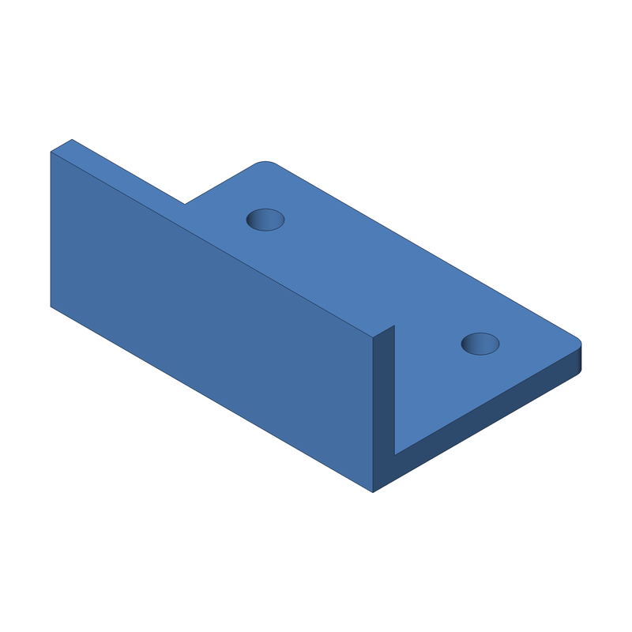

<div align="center">



# build123d starter

**Parametric, 3D-printable parts in Python.**

Write a model with [build123d](https://build123d.readthedocs.io), run `make`, get STL, STEP and OBJ files plus an isometric PNG preview.


</div>

---

Requires [uv](https://docs.astral.sh/uv/) and make.

```sh
make setup              # install deps into .venv (run once)
make                    # export build/example.{stl,step,obj,png}
make MODEL=mypart       # export models/mypart.py
make stl MODEL=mypart   # export only if build/mypart.stl is stale
make step MODEL=mypart  # export only if build/mypart.step is stale
make obj MODEL=mypart   # export only if build/mypart.obj is stale
make png MODEL=mypart   # export only if build/mypart.png is stale
make view MODEL=mypart  # export and show in the OCP viewer (needs it running)
make list               # list available models
make clean              # delete build/
make help               # show all targets
```

One exporter run writes all four files, so `stl`, `step`, `obj` and `png` each
rebuild everything when the model is out of date.

Add a part by copying `models/example.py`; each model defines `build()`.
See `CLAUDE.md` for conventions (written for AI agents, useful for humans too).

To reuse as a template: copy this folder, delete `.git`, `build/` and `.venv/`, rename the project in `pyproject.toml`, and replace `models/example.py`.

---

<p align="center">Built with ❤️ by <a href="https://x.com/aeksco">aeksco</a></p>
