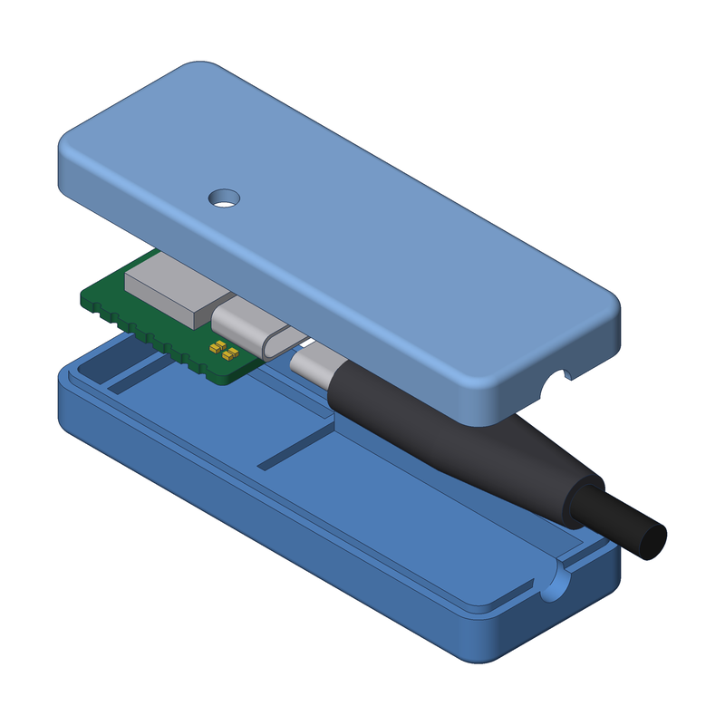

<div align="center">



# Mouse Mover

**A USB-C mouse jiggler on a Seeed XIAO in a 3D-printed case.**


</div>

---

The XIAO shows up to the host as a plain boot-protocol USB mouse and nudges
the cursor one pixel right and back every 45 seconds, so the machine never
goes idle. The case is a two-part glued shell that swallows the board and the
whole plug end of the USB-C cable, so only bare cable leaves through the end
wall. A small window in the roof sits over the XIAO's status LEDs.

## Hardware

- Seeed Studio XIAO SAMD21 (the original "Seeeduino XIAO")
- Any USB-C cable. The bay inside the case is sized loosely around a plug
  housing plus strain relief, so most cables fit without touching the model.
- CA glue to join the two halves

## Firmware

`MouseMover.ino` is a single Arduino sketch built on the
[HID-Project](https://github.com/NicoHood/HID) library.

1. In the Arduino IDE, add Seeed's board index under *Preferences →
   Additional boards manager URLs*:
   `https://files.seeedstudio.com/arduino/package_seeeduino_boards_index.json`
2. Install **Seeed SAMD Boards** from the Boards Manager and **HID-Project**
   from the Library Manager.
3. Select *Seeeduino XIAO*, open `MouseMover.ino` and upload.

The device identifies itself as `AlexMouseMover`. Set `DEBUG` to `true` at the
top of the sketch for a 5 second interval with a 1 second hold, which makes the
movement easy to see while testing.

## Enclosure

Every dimension and all of the geometry live in `models/xiao_enclosure.py`.
The other model files are thin wrappers that import from it:

| Model                | What it is                                              |
| -------------------- | ------------------------------------------------------- |
| `enclosure_bottom`   | Printable bottom half, floor on the bed, lip up         |
| `enclosure_top`      | Printable top half, flipped so the roof is on the bed   |
| `xiao_enclosure`     | Closed assembly: both halves, board and plug            |
| `enclosure_exploded` | Pulled-apart assembly (the render above)                |
| `xiao_board`         | Mock XIAO used for the fit check, not for printing      |
| `example`            | The starter template's bracket, kept as a reference     |

Requires [uv](https://docs.astral.sh/uv/) and make.

```sh
make setup                              # install deps into .venv (run once)
make MODEL=enclosure_bottom             # export build/enclosure_bottom.{stl,step,obj,png}
make MODEL=enclosure_top
uv run python scripts/check_fit.py      # overlaps, clearances and LED window alignment
make MODEL=enclosure_exploded           # refresh the render above
make list                               # list models
make clean                              # delete build/
make view MODEL=xiao_enclosure          # push to the OCP viewer (needs it running)
```

Each export writes STL for the slicer, STEP for CAD, OBJ for mesh tools and an
isometric PNG to `build/`. The exporter refuses invalid shapes and prints the
volume and bounding box.

### How it goes together

- The board drops into a pocket at the back and rests on a ledge. Ribs on the
  underside of the top hold it down.
- In front of the board a roomy bay takes the plug housing and strain relief,
  and the bare cable lays into a half-round notch in each half of the end wall.
- The bottom half has a thin lip around its wall and the top a matching groove,
  so the halves self-align before gluing.
- A 3.2 mm hole in the roof lines up with the 2x2 LED cluster beside the USB-C
  receptacle (power, user "L", RX and TX).

### Printing and tuning

Print both halves exactly as exported, flat side down, no supports. If a test
print is tight or loose, change one constant in `models/xiao_enclosure.py`
and re-export: `PCB_FIT_XY` for the board pocket, `LIP_CLEAR` for the seam,
`CABLE_HOLE_D` and `CABLE_BAY_*` for the cable, `LED_HOLE_D` for the window.
Run the fit check after any change and before printing.

## Layout

```
MouseMover.ino               firmware
models/xiao_enclosure.py     all dimensions and geometry for the case
models/enclosure_*.py        printable halves and assembly views
models/xiao_board.py         mock board
scripts/export.py            build a model, validate it, write STL + STEP + OBJ + PNG
scripts/render.py            headless isometric render
scripts/check_fit.py         overlap, clearance and LED window checks
```

See `CLAUDE.md` for the build123d conventions used here (written for AI
agents, useful for humans too).

---

<p align="center">Built with ❤️ by <a href="https://x.com/aeksco">aeksco</a></p>
